# 📘 Buku Sakti Pengguna: Dashboard Eksekutif v3.6.0+
*Panduan canggih buat bos-bos, manajemen, sampe tim IT yang mau tau rahasia dapur keuangan RS.*

---

## 🚀 1. Persiapan Masuk (Login & Keamanan)

Halo! Sebelum masuk ke dunia grafik yang warna-warni, pastiin dulu kamu punya akses ya. Dashboard ini udah kami suntik proteksi **Zero-Trust**. 

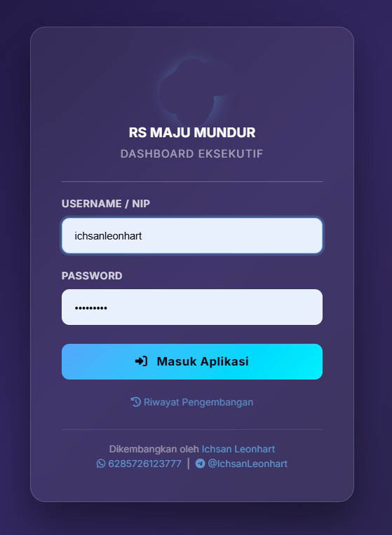

*   **Username & Password**: Pake akun SIMKES Khanza kamu.
*   **Hak Akses (Otoritas Khusus)**: GAK SEMUA ORANG bisa intip menu "piutang" atau "pihak ketiga". Cuma kamu yang akun Khanza-nya dicentang **'Harian Menejemen'** dan **'Bulanan Menejemen'** oleh tim IT yang bisa masuk. (Hubungi IT bila kamu belum punya akses ini). 
*   **Keamanan Ekstra**: Kalo salah password 6 kali, kamu bakal kena *lockout* (dikunci) selama 60 detik. Jadi, jangan asal tebak ya!

---

## 🧭 2. Menjelajahi Menu (Sidebar Masterclass)

Kita udah pecah menu-menu ini jadi kategori biar gak pusing carinya. Gunakan tombol hamburger `☰` di pojok kiri atas untuk menyembunyikan sidebar agar layar grafik jadi lebih luas.

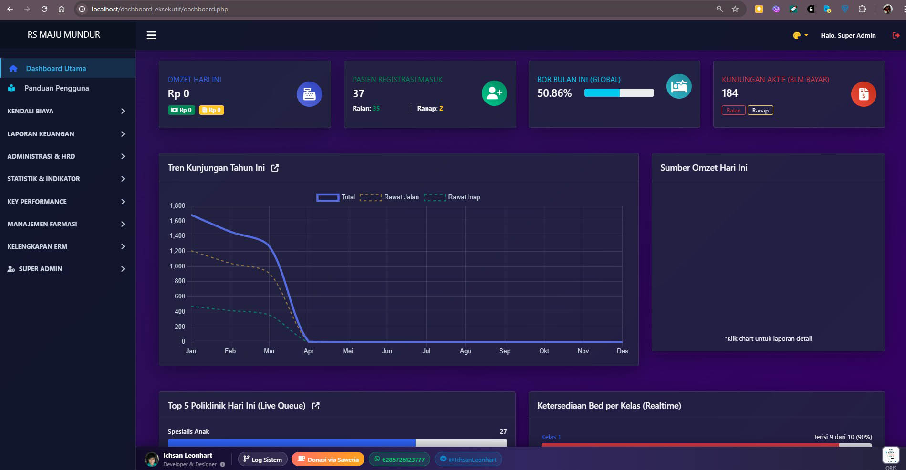

---

## 💼 3. Kendali Biaya (Biaya Riil vs Plafon)
*Bagian ini fokus pada pencegahan kebocoran biaya saat pasien masih dirawat.*

*   **Plafon Ranap**: Pantau biaya pasien yang opname secara *realtime*. Di sini kamu bisa lihat apakah billing pasien sudah mendekati plafon BPJS atau asuransi tertentu. Gak perlu nunggu pasien pulang buat tau billingnya sudah bengkak atau belum.
*   **Ketersediaan Bed**: Pantau okupansi bed dan kunjungan poli secara langsung untuk manajemen antrean.

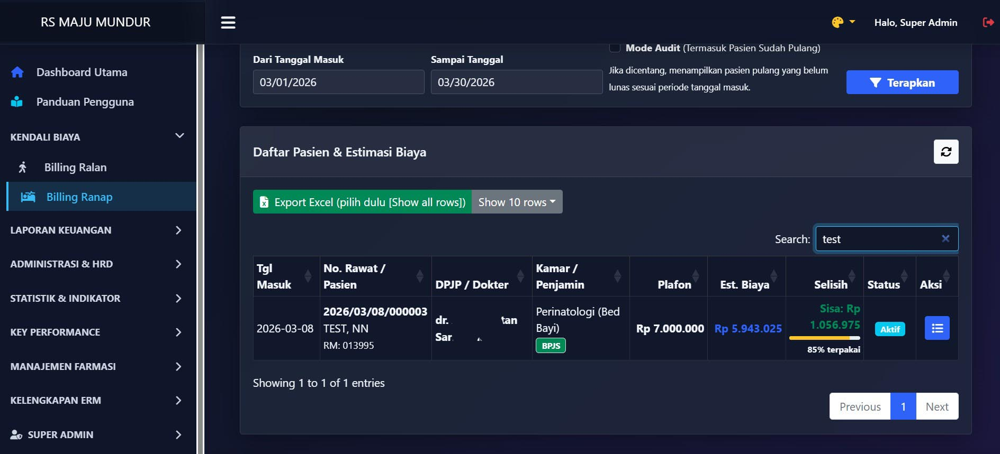
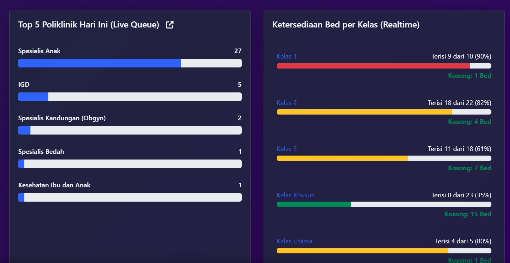

---

## 💰 4. Laporan Keuangan (Audit Omzet & Kas)
*Bagian ini digunakan untuk audit transaksi yang sudah terjadi (Billing selesai).*

*   **Laporan Kas**: Rekapitulasi uang yang benar-benar ada di tangan (tunai di brankas/kasir).
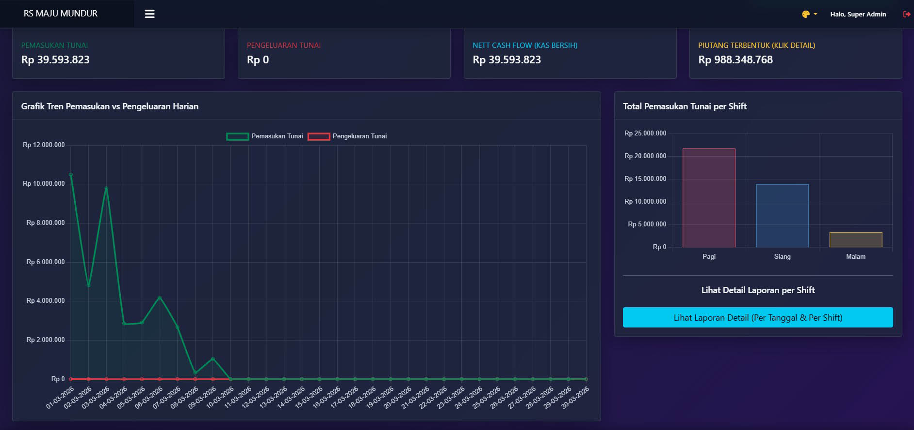

*   **Laporan Billing Kasir**: Audit omzet yang sudah ditransaksikan oleh kasir. Cek rincian nota untuk memastikan tidak ada kesalahan input tindakan.
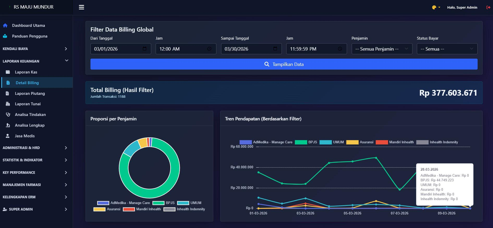
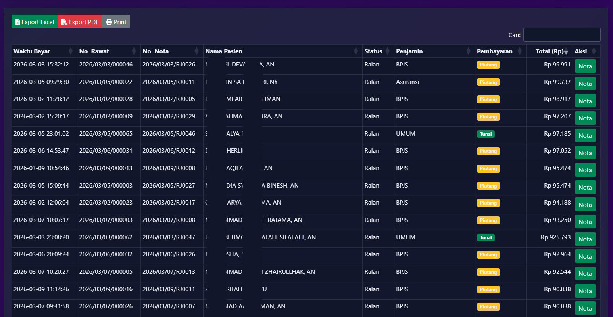
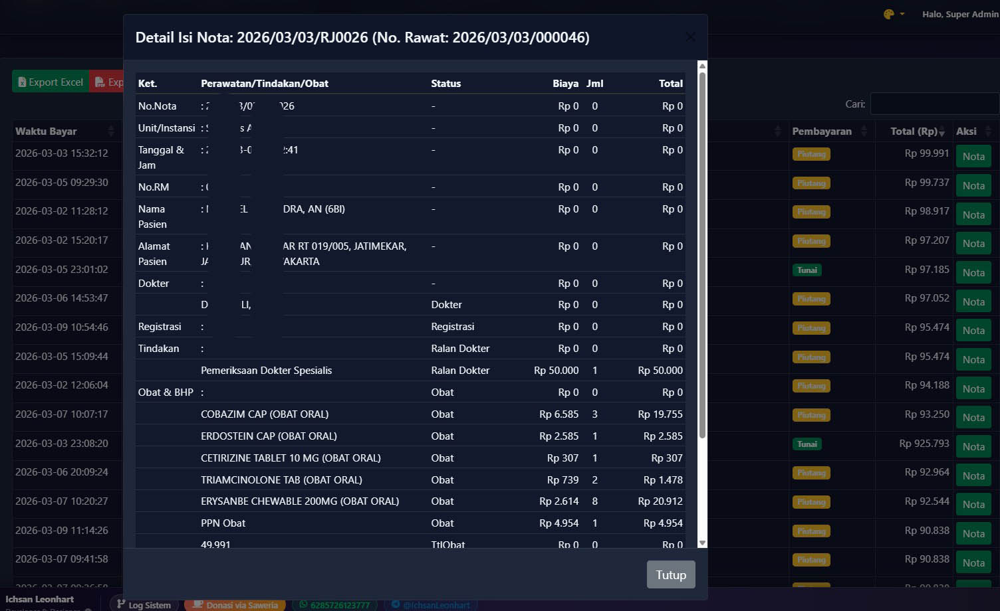

*   **Laporan Piutang**: Menu favorit Direktur! Di sini kelihatan semua **"Uang Kita di Luar"**. Berapa klaim asuransi yang belum cair atau bon pasien yang belum lunas.
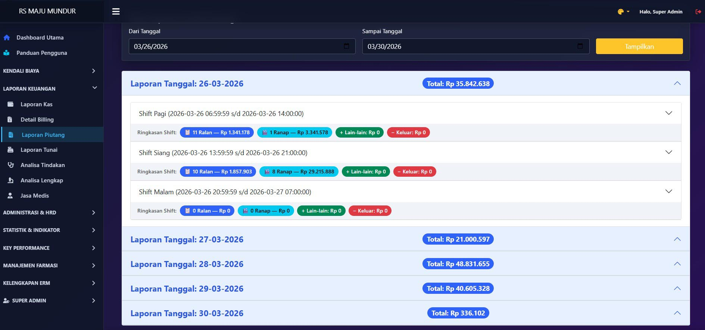
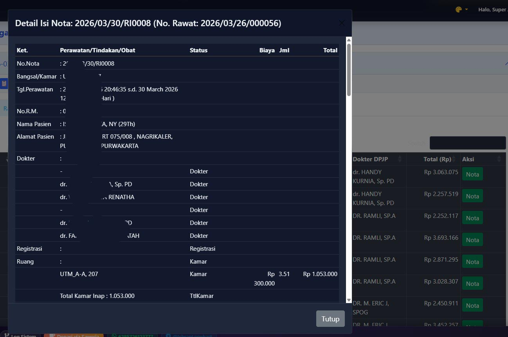

*   **Laporan Tunai (Detail Transaksi per Shift)**: Modul vital rekonsiliasi kasir harian. Menampilkan seluruh aliran kas masuk dan keluar yang dikelompokkan secara cerdas per tanggal dan per shift kasir.
    *   **Struktur Header Harian**: Menampilkan ringkasan total tanggal berjalan:
        *   `Masuk`: Akumulasi kas masuk riil dari seluruh shift (Ralan, Ranap, Obat & BHP, dan Pemasukan Lain-lain).
        *   `Keluar`: Akumulasi pengeluaran operasional kasir harian.
        *   `Sisa Kas`: Kas bersih yang disetor ke brankas/bendahara (`Masuk - Keluar`).
    *   **Pembagian Shift Otomatis (Dinamis dari SIMRS Khanza)**:
        Jam shift ditarik otomatis dari tabel master `closing_kasir`:
        *   **Shift Pagi**: `07:00:00` s/d `14:00:00`
        *   **Shift Siang**: `14:01:00` s/d `21:00:00`
        *   **Shift Malam (Shift ke-3 / Lintas Hari)**: `21:01:00` (Hari H) s/d `06:59:00` (Hari H+1).
    *   **Logika Otomatis Shift ke-3 (Malam Lintas Hari)**:
        *   Petugas kasir shift 3 bekerja semalaman mulai pukul 21:00 s/d 07:00 pagi keesokan harinya.
        *   Sesuai alur pembukuan dan setoran fisik keuangan manual, transaksi yang diinput pada **dini hari (00:00 s/d 06:59 pagi)**—seperti pelunasan piutang obat pukul 01:59 subuh—secara otomatis dihitung ke dalam **Shift Malam tanggal sebelumnya**.
        *   Uang fisik setoran kasir pagi hari saat serah terima kasir selalu sinkron 100% dengan rekapan shift di dashboard.
    *   **5 Tab Rincian Transaksi per Shift**:
        1.  **Tab Ralan**: Waktu Bayar, No. Rawat, No. Nota, Nama Pasien, Cara Bayar, Dokter, Total (Rp), dan Tombol `Nota` (pop-up rincian billing kasir).
        2.  **Tab Ranap**: Waktu Bayar, No. Rawat, No. Nota, Nama Pasien, Cara Bayar, Dokter DPJP, Total (Rp), dan Tombol `Nota`.
        3.  **Tab Obat & BHP (Penjualan Obat Bebas, Alkes & BHP Medis)**: Selaras 100% dengan SIMRS Khanza (`inventory.DlgCariPenjualan.java`):
            *   Menampilkan transaksi penjualan apotek tunai / lunas (`penjualan.status = 'Sudah Dibayar'`).
            *   Kolom: `No. Nota`, `Waktu Bayar`, `Petugas` (nama petugas tanpa NIP), `Pasien / Pembeli`, `Jns. Jual`, `Keterangan`, `Asal Stok`, `Akun Bayar`, `PPN`, `Ongkir`, `Total (Rp)`, dan `Aksi`.
            *   Dilengkapi tombol **Nota** yang memunculkan modal interaktif rincian item barang, batch, aturan pakai, diskon, embalase, tuslah, racikan, serta footer kalkulasi otomatis.
            *   Baris total di bawah tabel: `>> Total Penjualan Obat & BHP : Rp ...`.
        4.  **Tab Lain (Pemasukan Lain-lain)**: Selaras 100% dengan SIMRS Khanza (`keuangan.DlgPemasukanLain.java`):
            *   Kolom: `Nomor` (`no_masuk`), `Tanggal`, `Kategori`, `Petugas` (nama petugas langsung tanpa NIP agar bersih), `Pemasukan` (Rp), `Terima Dari` (nama penyetor), dan `Keperluan`.
            *   Dilengkapi baris total otomatis di bawah tabel: `>> Total Pemasukan : Rp ...`.
        5.  **Tab Keluar (Pengeluaran Harian)**: Rincian biaya operasional kasir: Tanggal, Kategori, Keterangan, dan Biaya (Rp).
    *   **Badge Ringkasan Shift**: Setiap panel shift dilengkapi indikator instan: `[Ralan]` + `[Ranap]` + `[💊 Obat/BHP]` + `[+ Lain-lain]` - `[- Keluar]` = `[= Setoran Shift]`.
.jpg)

*   **Analisa Tindakan**: Ketahui unit atau dokter mana yang paling produktif dalam memberikan tindakan medis.
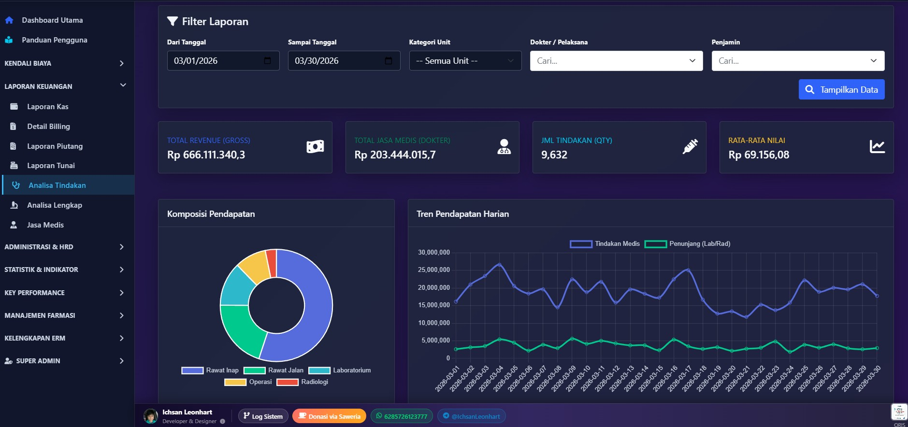

*   **Jasa Medis**: Monitor pembagian hak jasa medis dokter dan perawat secara transparan.
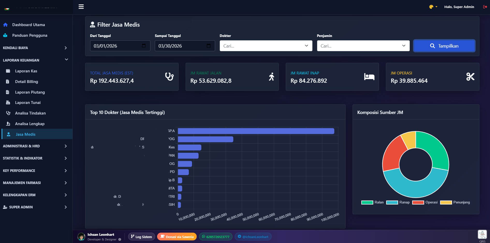
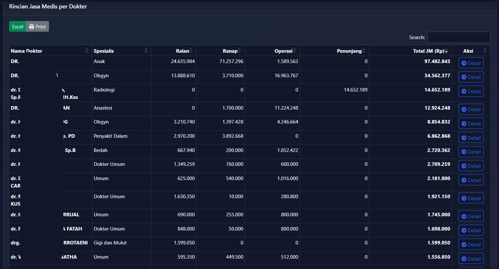

---

## 📅 5. Administrasi & HRD (Monitoring Pegawai & Legalitas Nakes)

*   **Kepegawaian & Audit Berkas Pegawai**:
    *   **List & Index Pegawai**: Manajemen biodata, data penempatan, pendidikan, dan kalkulasi index penggajian terintegrasi dengan SIMRS Khanza.
    *   **Audit Kelengkapan Berkas**: Pemantauan pemenuhan checklist dokumen per kategori profesi (Dokter Umum, Dokter Spesialis, Perawat & Bidan, Profesi Lain, dan Tenaga Non-Klinis).
    *   **Dashboard Monitoring Surat Izin Praktik (SIP) Nakes**:
        *   Ditempatkan tepat di atas filter kategori untuk visibilitas maksimal manajemen HRD/Direksi.
        *   Menyajikan 6 Kartu KPI pemantauan izin legalitas:
            1.  **Total Nakes**: Rekap seluruh tenaga kesehatan aktif di RS yang wajib mengantongi SIP.
            2.  **Masa Aman**: Jumlah SIP yang masa berlakunya masih lebih dari 90 hari.
            3.  **Peringatan (31 - 90 Hari)**: Memberikan waktu yang cukup bagi manajemen untuk mengingatkan nakes mengajukan perpanjangan izin.
            4.  **Masa Kritis (≤ 30 Hari)**: Peringatan intensif perpanjangan segera agar tidak melewati batas izin praktik.
            5.  **Kadaluarsa**: Daftar nakes yang izin praktiknya telah berakhir dan harus segera ditindaklanjuti.
            6.  **Belum Upload**: Nakes yang berkas fisik SIP-nya belum diunggah ke sistem.
        *   **Filter Interaktif**: Cukup klik salah satu kartu KPI di dashboard, daftar pegawai di sebelah kiri otomatis tersaring sesuai kategori masa berlaku SIP yang dipilih.
    *   **Input & Pengaturan Masa Berlaku SIP**:
        *   Pada saat mengunggah berkas SIP (`DOK0005`, `DOK0011`, `DOK0017`, `DOK0023`), form upload otomatis menyediakan kolom input **Nomor SIP**, **Tanggal Terbit**, dan **Tanggal Kadaluarsa / Masa Berlaku**.
        *   Tersedia tombol **"Atur SIP"** di samping berkas tersimpan agar admin kepegawaian dapat mengisi atau memperbarui masa berlaku izin kapan saja tanpa harus mengunggah ulang file.
        *   **Sinkronisasi Otomatis Khanza**: Input Nomor SIP untuk dokter otomatis memperbarui kolom `no_ijn_praktek` pada tabel master `dokter` di SIMRS Khanza.

*   **Laporan Absensi**: Pantau kedisiplinan pegawai, dari jam masuk, keterlambatan, hingga rekapitulasi ketidakhadiran secara visual.
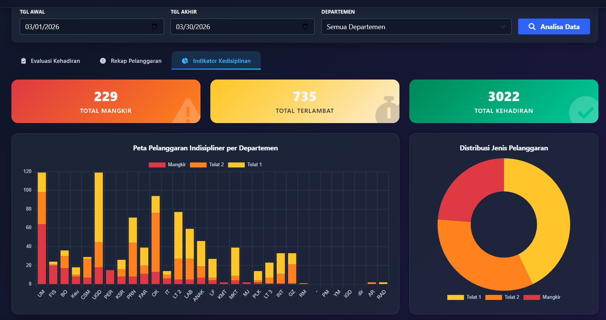
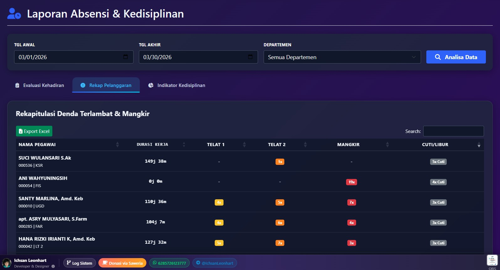

---

## 📊 6. Statistik & Indikator (Data Akreditasi)

*   **Kunjungan RS**: Dashboard interaktif untuk melihat tren kunjungan pasien harian, mingguan, hingga tahunan.
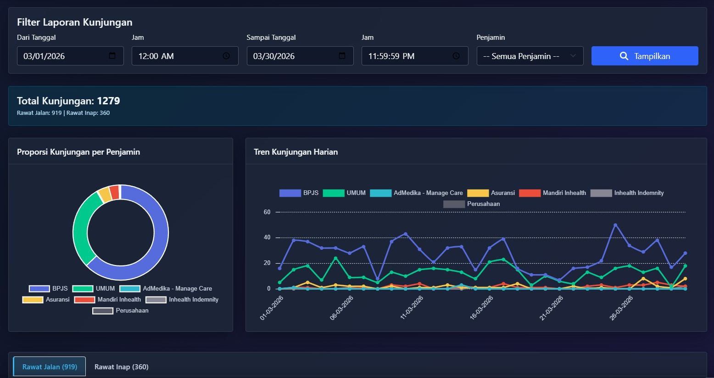

*   **BOR LOS TOI**: Indikator efisiensi pemakaian tempat tidur rawat inap. 
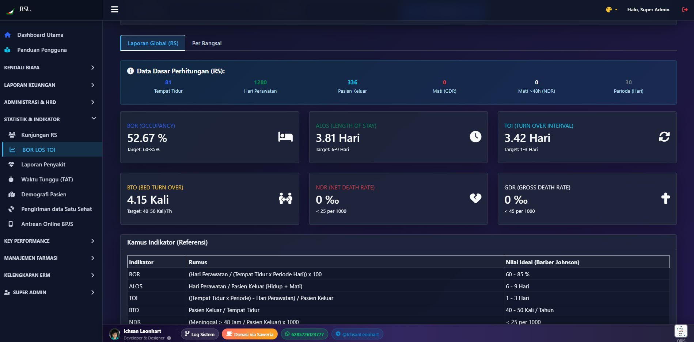
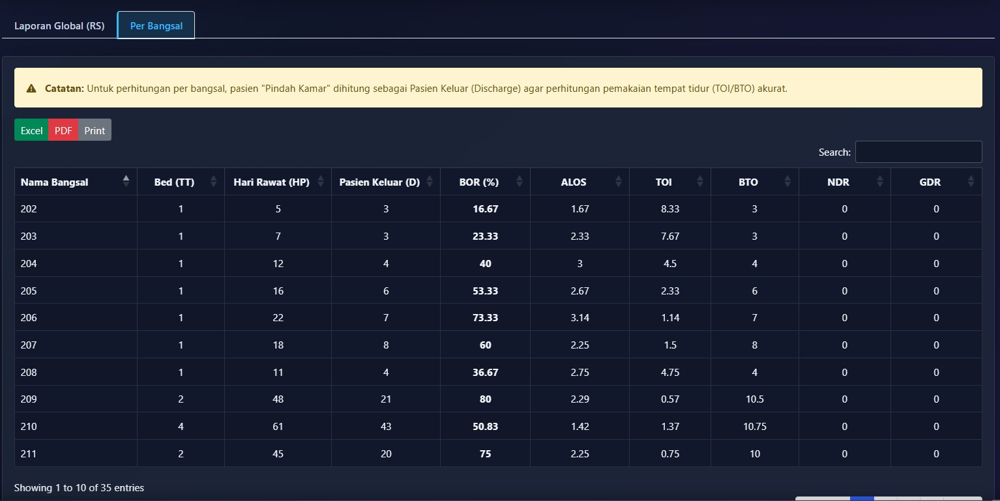

*   **Laporan Penyakit**: Visualisasi 10 besar diagnosa penyakit (ICD-10) untuk perencanaan stok obat dan alat kesehatan.
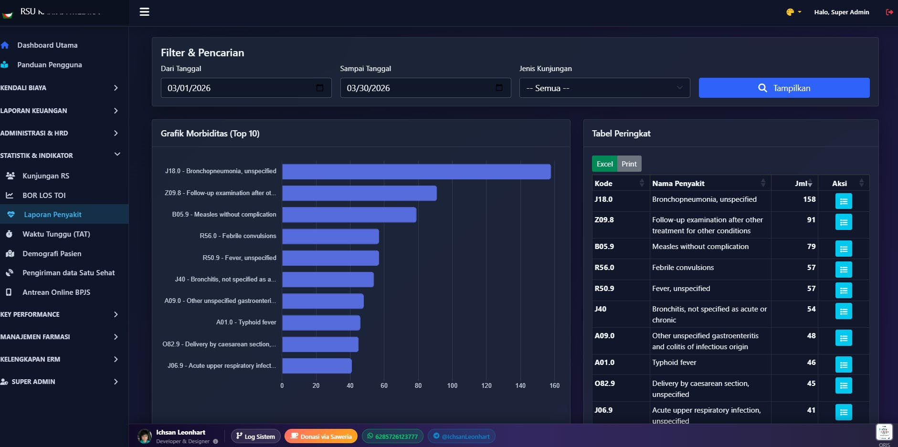

*   **Waktu Tunggu (TAT)**: Pantau kecepatan pelayanan dari pendaftaran hingga pasien menerima obat. Crucial untuk kepuasan pasien!
.jpg)

*   **Demografi Pasien**: Pemetaan wilayah asal pasien dan segmentasi umur pengguna layanan RS.
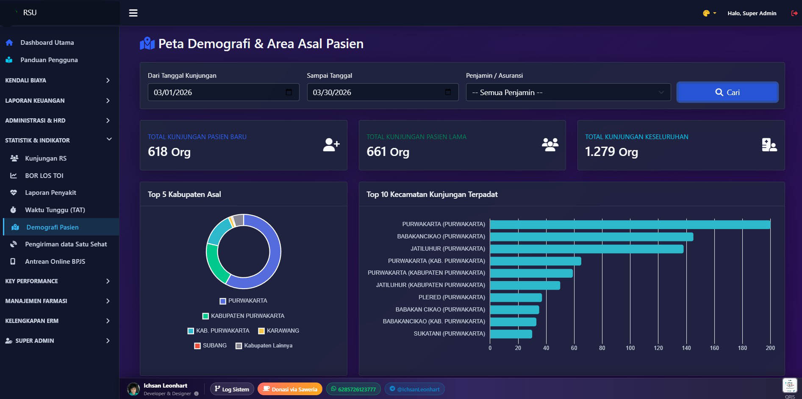

*   **Kepatuhan Satu Sehat & Antrol**: Monitoring integrasi data ke Kemenkes dan validitas Task ID antrean online BPJS.
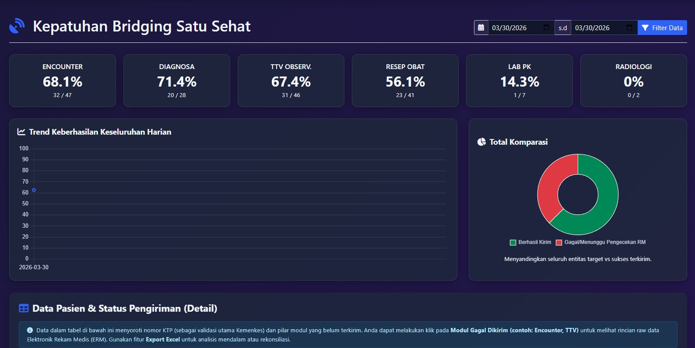
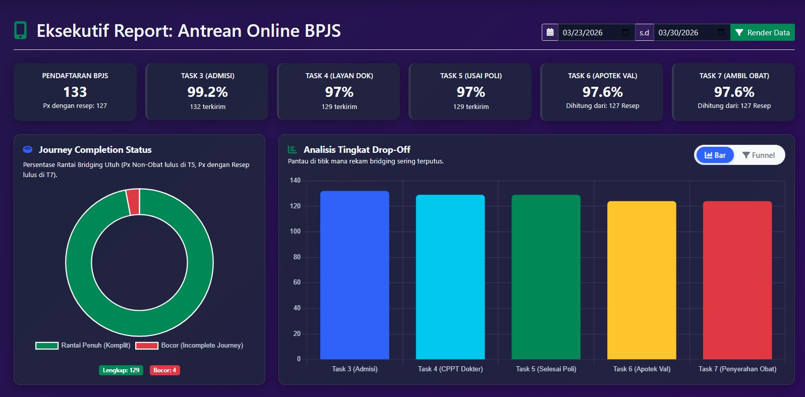

---

## 🏆 7. Key Performance (KPI & Kinerja)

*   **Kinerja Dokter**: Evaluasi produktivitas dokter berdasarkan volume pasien dan revenue yang dihasilkan.
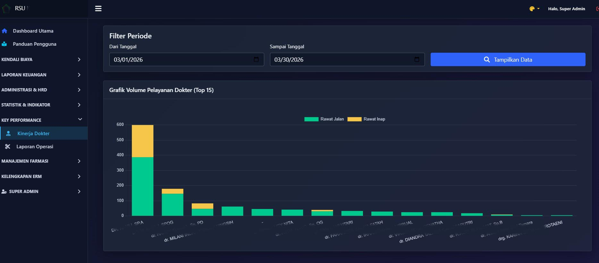
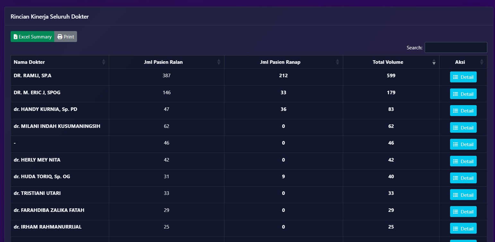

*   **Laporan Operasi**: Rekapitulasi tindakan bedah berdasarkan tingkat kesulitan dan performa operator.
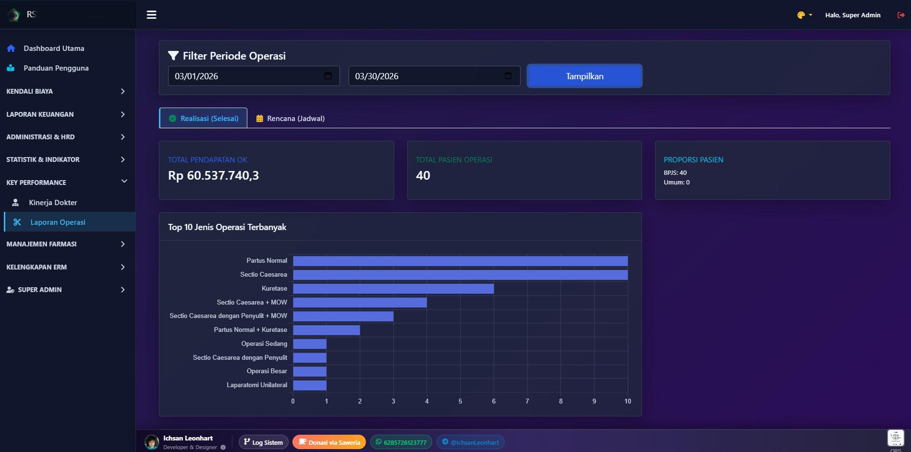
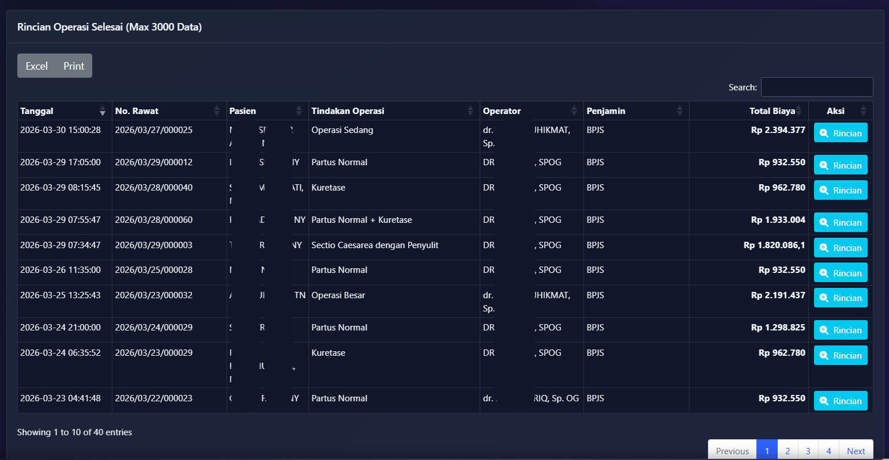

---

## 💊 8. Manajemen Farmasi (Gudang Cuan)

*   **Monitoring Stok**: Pantau stok berjalan di gudang farmasi dan apotek secara real-time.
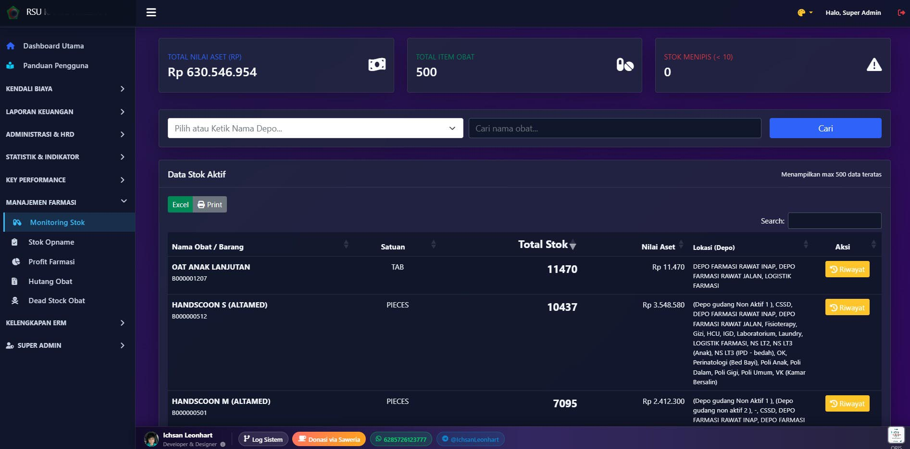

*   **Profit Farmasi**: Analisa keuntungan dari penjualan obat dan pemberian resep.
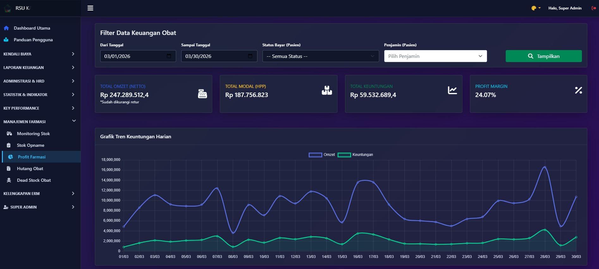
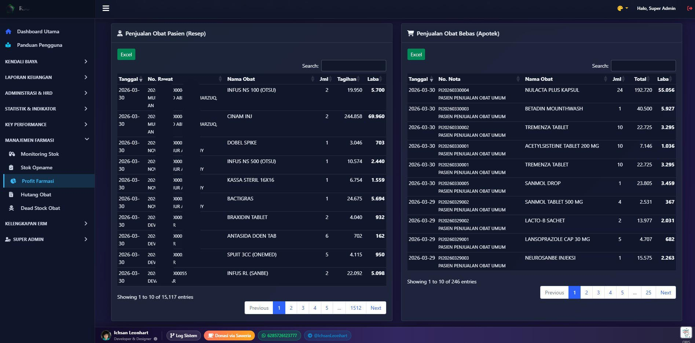

*   **Hutang Obat**: Reminder jatuh tempo pembayaran kepada supplier/PBF.
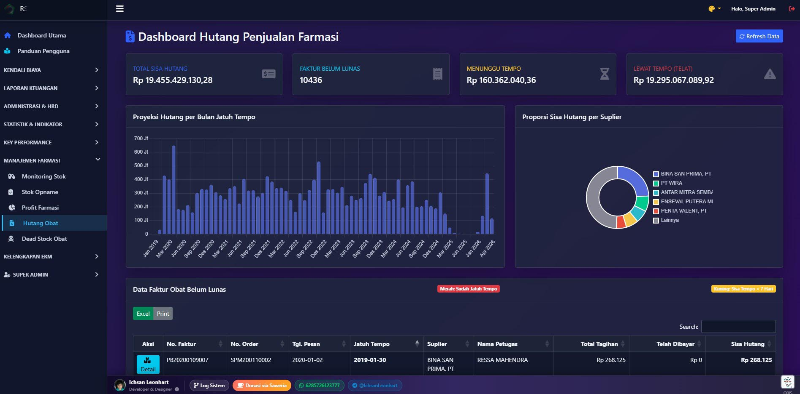

*   **Dead Stock / Slow Moving**: Identifikasi obat yang tidak laku/lambat bergeraknya untuk mencegah kerugian expired.
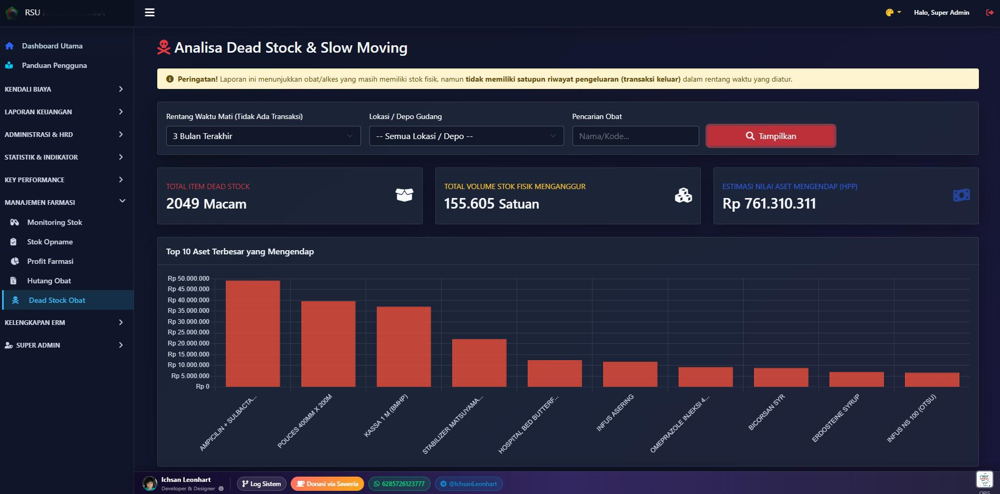

---

## 📝 9. Kelengkapan ERM (Audit Mutu)

*   **Audit Kepatuhan ERM**: Sistem cerdas yang mengaudit kelengkapan pengisian Rekam Medis Elektronik oleh para PPA (Dokter/Perawat).
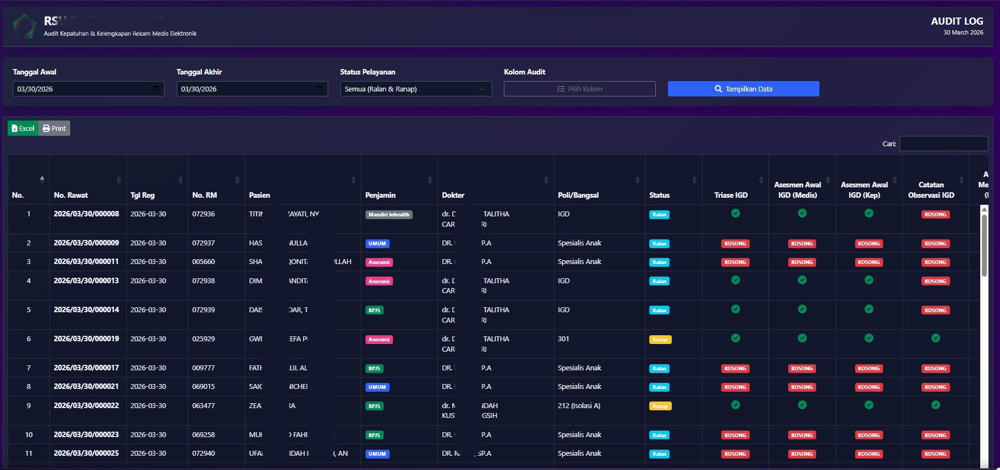

---

## 🎨 10. Fitur Premium Dashboard

Aplikasi ini gak cuma pinter, tapi juga ganteng!
*   **Sistem Tema**: Ganti suasana hati di pojok kanan atas (Bright, Glass Solid, Glass Animated).
*   **Mode Glass**: Mode futuristik tembus pandang yang nyaman di mata.
*   **Grafik Interaktif**: Klik legenda di grafik (Chart.js) buat memfilter data secara dinamis tanpa reload.

---

## 🛠️ 11. Pojok IT (Onboarding)

Buat bang admin IT yang baru pasang:
1.  **Aktivasi Database**: Jika instalasi awal, pastikan file `config/koneksi.php` sudah terhubung ke database Khanza.
2.  **Copyright Protection**: Jangan menghapus atau menyembunyikan link developer di footer (Rule #17) atau aplikasi akan masuk ke mode *Self-Destruct* (Blank Page).
3.  **Donasi**: Klik nama developer di bawah buat kirim apresiasi kopi agar fitur baru terus rilis!

---

*Tertanda,*
> *"Data itu kayak perasaan, kalo gak dirawat bisa ilang pelan-pelan."*
